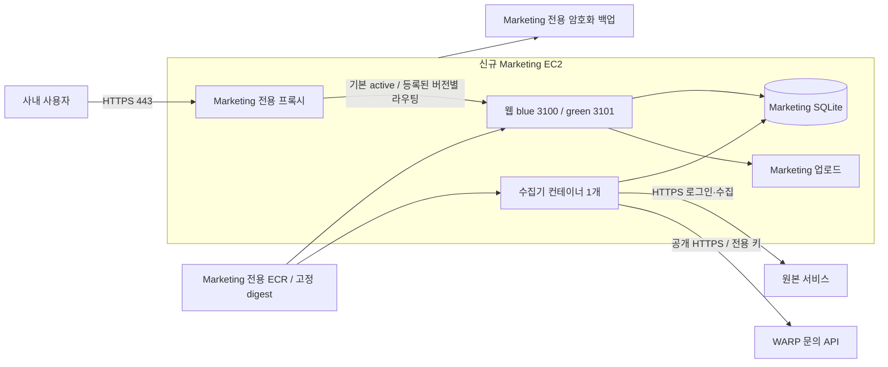

# Marketing 전용 서버 수정·배포 계획

작성: 2026-09-18 KST. 대상: EVNSolution/EVN-MARKETING PR #1, `a7bf7d0b2f7c09ddfca3807bc477beb52c201b06`.

이 문서는 구현 검토를 위한 계획 PR의 일부입니다. 서버 생성, DNS/IAM/비밀값 변경, 고객 자료 이전, 이미지 게시, 머지와 배포는 실행하지 않았습니다. PR #1의 기존 동거 서버 전제를 전용 서버로 바꾸며, 실제 수정은 아래 작업 단위로 진행해야 합니다. 발견사항은 [PR 검토서](pr-1-review.md), 일반 배포의 단계·실패 분기·인수 검사는 [WARP 방식 무중단 배포 명세](zero-downtime-deployment-plan.md)를 따릅니다.

## 1. 결정할 기본 구조

**Marketing 전용 신규 EC2 1대**를 기본안으로 합니다. 2026-09-23 현재 선택한 시작 크기는 서울 리전의 Ubuntu 24.04 LTS x86_64, `t3a.small`(2 vCPU/2 GiB), 암호화 gp3 40 GiB입니다. `t3.small`(2 GiB)과 `t3a.medium`·`t3.medium`(각 4 GiB)은 크기 조정 후보입니다. 아래 원래 2026-09-18 계획의 `t3.medium` 4 GiB는 역사적 측정 가정이었으며 현재 기본값이 아닙니다. 실제 수용량은 아직 입증되지 않았습니다. WARP 인스턴스 증설·동거는 이 계획의 선택지에 포함하지 않습니다.

- 릴리스 완료 상태의 웹과 수집기는 **동일 이미지 digest**를 각각 `server.js`, `worker.mjs`로 실행합니다. 전환 동안 웹 두 버전과 worker 한 개의 N/N-1 호환성을 유지합니다. 데이터는 같은 호스트의 로컬 영속 볼륨을 공유합니다. SQLite를 네트워크 파일시스템이나 여러 서버에 걸쳐 공유하지 않습니다.
- WARP의 CPU/RAM/디스크/컨테이너/배포 잠금/비밀값 경로/백업은 공유하지 않습니다. Marketing 장애 시 WARP로 가는 등록 요청만 지연되어야 합니다. WARP 장애 시 문의 원본은 Marketing에 남고 전송 대기합니다.
- 동일 AWS 계정·리전을 쓸 경우 계정 및 리전 장애까지 분리되는 것은 아닙니다. 전용 인스턴스는 서비스 자원과 배포의 장애 영향을 분리합니다. 일반 앱 배포는 blue/green으로 웹 요청을 유지하도록 구현하되, 단일 서버의 호스트/AZ 장애까지 막는 고가용성 구성으로 표현하지 않습니다.
- `marketing.cleversystem.ai`는 **제안 주소**입니다. 기존 문서의 DNS/SSM 미존재 기록은 과거 기록이며 이번에 AWS 상태를 조회하지 않았습니다.

## 2. 구현 작업 단위와 완료 조건

| 순서 | 수정 대상 | 구체적 변경 | 통과 조건 |
| --- | --- | --- | --- |
| A — 공개 전 보안 | 고객 PUT, 명함/문서 업로드·삭제, 업로드 GET, 상세 화면 returnTo | 저장 URL을 신뢰한 파일 삭제 제거, 고객별 업로드 경계 검사, 경로 필드 서버 소유, 개인정보 캐시 `private, no-store`, 파일 크기·형식·총량 제한, returnTo 내부 경로 allowlist | 합성 경로 탈출·다른 고객 파일 삭제 거부, 정상 교체/삭제 유지, 로그아웃 후 캐시 재사용 차단, 과대 업로드 413, 외부/스크립트 URL 거부 |
| B — 수집 복구 | `workers/inquiry-sync.ts`, 관련 테스트 | 명시적 collector 활성화 gate, 자동 로그인 일시 실패의 제한된 재시도/backoff, 중단 시 루프 종료와 lease 정리, 브라우저 crash 후 복구 상태 검증 | 기본 비활성, 첫 로그인 실패 후 회복, 세션 만료 재로그인, SIGTERM 및 강제 종료 후 단일 소유자 복귀 |
| C — 전송 대기열 | `lib/warp-delivery.ts`, 테스트 | 영구 400/413 오류 격리 및 신규 정상 행의 처리 보장, 기존 409 충돌 보류 유지 | 오래된 불량 50건 뒤 정상 건도 진행, 응답 유실 재시도 시 같은 activityId, 완료 이력 재전송 금지 |
| D — 운영 명령 패키징 | `Dockerfile`, `.dockerignore`, 운영 smoke | 기존 check/pilot 스크립트도 JS 번들로 포함; source/tsx/Prisma CLI 전체를 운영 이미지에 넣지 않음 | 네트워크 차단 최종 이미지에서 CLI 존재·no-key fail-closed; 합성 pilot/중복 검사는 기존 fetch 주입 모듈 테스트; 실제 이미지의 인증 check/pilot은 승인 후 운영 단계 |
| E — 독립 무중단 배포 | 운영 Compose, release workflow, 배포·rollback/프록시 스크립트 | digest 필수·서버 build 금지, 웹 두 슬롯, worker 순차 인계, CI+호스트 잠금, readiness/journal/Next 버전 라우팅, 고정 volume, 자원·로그 제한 | [Z01–Z10 인수 검사](zero-downtime-deployment-plan.md#7-필수-인수-검사), 전환 요청 오류/성공 데이터 유실 0, 완료 상태 웹/worker digest 일치 |
| F — 자료 보존 | backup/restore 도구·운영 절차 | 모든 writer 정지, 일관된 SQLite+업로드 묶음/manifest, 오프호스트 보관, 복원 점검 | 별도 빈 볼륨 복원 후 무결성·행 집계·전송 필드·업로드 hash 일치, 실제 복구 시간 기록 |
| G — 문서·검사 | `README.md`, `docs/production-deployment.md`, `CLAUDE.md`, PR CI | 동거 전제 제거; 오래된 “Git/lockfile/CI/migrations 없음” 정정; lint 및 위 회귀 검사 추가; 이미지 OS/런타임 패키지 검사 | 문서의 모든 명령이 최종 이미지에서 실행 가능, CI 성공/운영 검증을 분리한 완료 기록 |
| H — 향후 schema 변경 경로 | 별도 migration build target/작업·절차 | 동일 소스 SHA의 migrations+기존 Prisma CLI를 별도 ops image에 패키징하고 별도 digest 기록; 웹/worker runtime에는 CLI를 추가하지 않음 | 복원본 dry run, 단일 migration lock, 전후 integrity/ledger 검사, 실패 시 웹/worker 시작 차단 및 호환 rollback 판단. 최초 이관은 ledger 검증만 하고 불필요한 migration을 실행하지 않음 |
| I — 양쪽 복원 시점 불일치 | Marketing의 제한된 복구 명령·운영 절차 | 원본 sourceId와 기존 receipt를 보존하는 dry-run 대상 manifest, 승인된 소수 대상의 HTTPS 재전송/수신 확인, 배치 상한·중단·감사 기록 | Marketing만 과거/WARP만 과거인 두 합성 시나리오에서 누락·중복 검증; 일반 worker는 완료 이력을 재전송하지 않음 |

외부 `/api/external/leads`의 동일 전화번호 동시 생성 문제도 별도 수정합니다. 기존 고객에 중복이 있을 수 있으므로 곧바로 UNIQUE migration을 적용하지 않습니다. 정규화 규칙과 기존 충돌 처리부터 확정하고 동일 번호 동시 요청을 직렬화/충돌 처리하는 회귀 검사를 추가합니다. 이 경로의 수신 키는 필요성이 확인될 때까지 비워 비활성화합니다. 고객 역할별 권한 정책은 현재 구현만으로 의도를 단정하지 않으며, 전체 API를 임의로 admin 전용으로 바꾸지 않습니다.

## 3. 이미지 보관과 배포

1. Marketing 전용 private ECR 저장소 `evn-marketing`을 제안합니다. immutable SHA 태그와 digest, 소스 SHA, 아키텍처, 빌드 실행 URL, 이미지 검사 결과를 함께 보관합니다. 현재·직전 정상 digest를 lifecycle 정책에서 보호합니다. [ECR immutable tags](https://docs.aws.amazon.com/AmazonECR/latest/userguide/image-tag-mutability.html)
2. PR CI는 계속 합성 데이터만 사용합니다. 별도 release workflow가 승인된 SHA를 `linux/amd64`로 빌드·검사·게시합니다. PR/포크 코드에 AWS 쓰기 권한을 주지 않습니다.
3. GitHub OIDC 역할은 이 저장소와 지정한 운영 environment/ref에만 신뢰를 허용하고 Marketing ECR 게시 및 Marketing 대상 배포만 허용합니다. 기존 WARP 역할을 확장하지 않습니다. 동시 release는 서비스 단위 잠금으로 하나만 실행합니다.
4. 호스트 역할은 Marketing ECR pull, 명시한 Marketing SSM 파라미터 읽기, Marketing 백업 및 관측에 필요한 권한만 갖습니다. 부팅 및 재시작 경로는 systemd와 Docker를 통해 명시합니다. [EC2 instance profile/SSM](https://docs.aws.amazon.com/systems-manager/latest/userguide/session-manager-getting-started-instance-profile.html)
5. 일반 배포 순서: digest/최근 일관된 백업 확인 → active 유지 상태에서 후보 웹 준비·readiness → old worker drain → 프록시 전환·외부 확인 → new worker 하나 시작 → 관측·journal commit → 직전 웹 보관. 세부 실패 분기는 무중단 배포 명세를 따릅니다. 최초 이관에서는 worker/전송을 계속 끈 채 자료 검증을 먼저 합니다.
6. 고정 Compose project 이름 `evn-marketing`과 고정 external volume 이름 `evn-marketing-data`를 제안합니다. release 디렉터리가 바뀌어 새 빈 DB가 생기지 않도록 합니다. 운영에는 `down -v`를 사용하지 않습니다. [Docker 볼륨 수명](https://docs.docker.com/engine/storage/volumes/)
7. readiness는 로그인 페이지 HTTP 200 외에 DB schema/연결을 확인해야 합니다. 수집기 정상 여부는 별도 heartbeat·마지막 성공 수집 시각으로 판단합니다. 진단 출력은 상태와 revision만 포함합니다.
8. 구버전 이미지 롤백은 DB 호환성을 먼저 확인합니다. 이미 새 문의/등록이 발생했으면 오래된 DB를 덮어쓰지 않습니다. 향후 schema 변경은 migration 전용 작업과 사전 백업으로 분리하며 컨테이너 시작에 seed/db push를 넣지 않습니다.

현재 WARP endpoint는 코드에 고정되어 있습니다. CI에서 운영 CLI에 합성 키를 넣어 실제 WARP로 보내지 않습니다. 합성 발신 모듈 검사는 기존 `send` 주입 지점을 사용하고, packaged CLI의 no-key 검사는 네트워크를 차단합니다. 정상 인증이 필요한 end-to-end CLI 검사는 전환 승인 후에만 수행합니다.

## 4. HTTPS와 비밀값 주입

- 신규 호스트의 전용 Nginx/ACME 구성을 제안합니다. 443을 공개하고 80은 인증서 발급·HTTPS 리다이렉트 용도로만 사용합니다. 웹 blue/green 3100·3101과 컨테이너 3000은 외부에 열지 않습니다. 관리 접속은 SSM을 우선합니다.
- DNS A 레코드는 신규 고정 IPv4를 가리킵니다. AAAA는 IPv6가 실제 준비된 경우에만 추가합니다. 인증서 자동 갱신·만료 경보와 재부팅 후 프록시 복구를 검사합니다. 인증서 발급 전에는 실데이터 로그인 화면을 공개하지 않습니다.
- 프록시는 Host를 최종 도메인으로 검증하고 `X-Forwarded-Host/Proto`를 직접 설정합니다. 인증 URL 두 값은 최종 HTTPS 주소로 고정합니다. 요청 body 제한, 로그인 시도 제한, 업로드 경로 캐시 비활성화를 포함합니다. TLS 로그에는 쿠키·키·요청 본문을 남기지 않습니다.
- 비밀값 저장소는 Marketing 전용 SSM SecureString 경로를 제안합니다. 값별 이름을 명시하고 WARP의 파라미터 경로에는 읽기 권한을 주지 않습니다. 원본 계정, Marketing `AUTH_SECRET`, WARP 등록 전용 키는 담당자의 승인된 보안 경로로 각각 주입합니다. WARP 전체 환경값 조회/복사나 BUILDUP 키 재사용은 금지합니다.
- 부팅용 launcher는 호스트 역할로 정해진 파라미터만 가져와 Compose 자식 프로세스 환경에 전달합니다. 파일·명령 인자·shell tracing·로그·CI artifact에 값을 쓰지 않습니다. fetch 실패나 일부 누락이면 시작을 중단합니다. Compose 환경변수는 Docker 관리자에게 보일 수 있으므로 Docker socket/운영 권한을 제한합니다.
- 기존 앱은 환경변수를 읽으므로 Compose secrets를 선언하는 것만으로 동작하지 않습니다. 파일 방식으로 전환하려면 명시적 reader/entrypoint 변경과 권한 검증이 필요합니다. [Compose secrets](https://docs.docker.com/compose/how-tos/use-secrets/)
- worker에는 원본 계정과 WARP 키를 주고 웹에는 인증용 값만 주는 것이 목표입니다. 현재 UI가 `warpConfigured()`로 키 존재 여부를 확인하므로, 웹에서 전용 키를 빼기 전 비밀값이 없는 상태 표시 방식으로 수정합니다. `AUTH_SECRET`은 Marketing용 독립 값이며 기존 사용자 비밀번호 해시와 별개입니다.
- `WARP_DELIVERY_ENABLED=false`가 초기값입니다. check/pilot·CRM 검증을 완료한 이후 별도 전환 단계에서 켭니다. 키 존재만으로 자동 전송하지 않습니다. 재부팅 때도 같은 승인값을 복구해야 합니다.

## 5. 영속 데이터와 이전 절차

컨테이너 경로는 `/data/marketing.db`, `/data/uploads`를 유지합니다. 전용 암호화 EBS 위 고정 볼륨을 사용하고, 이미지의 실제 UID/GID를 확인해 DB/디렉터리 소유권을 설정합니다. 월드 쓰기 권한 `777`은 CI의 임시 구성일 뿐 운영에 복사하지 않습니다. worker에 업로드 쓰기 권한이 필요하지 않도록 볼륨 분리/마운트 권한도 검토합니다.

1. 합성 데이터로 새 이미지·전용 서버 후보의 로그인 보호, DB 접근, Chromium, 동시 웹 사용과 수집, 백업·복원을 리허설합니다. 서버 밖에서 빌드합니다.
2. 승인된 전환 시각에 **기존 Mac과 모든 실행 위치**의 수집기/전송 CLI를 확인하고 자동 재실행 설정까지 중지합니다. 로컬 웹의 고객/파일 변경과 외부 리드 수신도 멈춥니다. 종료 코드·프로세스 종료·worker lease 해제를 집계로 기록합니다. 별개 DB끼리 lease를 공유하지 않습니다. 후속 구현에는 명시적 collector 활성화가 없으면 종료하는 gate를 추가하고 서버만 활성화합니다. 승인된 전환에서 로컬 source/WARP 자격증명의 자동 주입 경로를 폐쇄하고 Mac 재부팅 후에도 수집기가 시작되지 않는 것을 확인합니다. 원본 서비스가 계정/IP별 제한을 제공하면 서버 전용 제한을 우선합니다. 제공하지 않으면 이전 코드와 자격증명을 가진 사람이 수동 실행하는 것까지 기술적으로 차단했다고 주장하지 않습니다.
3. writer가 멈춘 상태에서 SQLite backup API로 DB 전체를 복사하고 업로드를 동일 시점의 묶음으로 보존합니다. WAL 상태의 DB 파일 하나를 단순 복사하지 않습니다. DB backup API 자체는 업로드의 일관성까지 보장하지 않습니다. [SQLite Online Backup](https://sqlite.org/backup.html)
4. 검토·로그용 `backup-summary` manifest에 소스 SHA, 생성 시각, DB/파일 묶음 SHA-256, 크기·파일 수, migration 이름/체크섬, 테이블별 행 수, 문의/전송 상태별 집계만 기록합니다. UUID 목록, 전화번호, 원문, 비밀번호 해시는 출력하지 않습니다. 민감 필드 비교는 비공개 도구 내부에서 수행하고 일치 여부만 출력합니다. 복구 대상 sourceId를 담는 `recovery-targets` manifest는 이 요약과 별개이며, 암호화·운영자 접근 제한을 적용하고 문서/Git/로그에 포함하지 않습니다.
5. `Inquiry` 전체와 `warpCustomerId`, `warpActivityId`, `warpDeliveredAt`, `warpAttemptedAt`, `warpError`, 수집 run/state와 cutoff, 기존 사용자/팀/고객/활동 및 `_prisma_migrations`를 보존합니다. 없는 필드나 migration ledger를 있는 것으로 간주하지 않습니다. mismatch가 있으면 전환 전에 멈추고 확인합니다.
6. **409건/등록 406건/충돌 3건/사용자 1명은 개발자 과거 기록**입니다. 이번에는 현재 DB를 읽지 않았습니다. 실제 전환 시 최신 집계와 전송 receipt를 재산출하며 이 숫자를 고정 기대값으로 쓰지 않습니다.
7. 승인된 암호화 채널로 이전하고 송·수신 checksum, SQLite `integrity_check`, `foreign_key_check`, 모든 업무 테이블과 이력의 동일성을 검증합니다. 업로드 경로/크기/hash 및 DB 참조 누락을 검사합니다. 기존 파일을 덮어쓰지 않고 신규 볼륨에 복원합니다.
8. worker/전송을 끈 채 웹을 시작해 실제 HTTPS에서 기존 계정 로그인, 문의 상태, 고객 및 권한 있는 업로드 열람을 확인합니다. 개발 seed 계정/약한 공용 비밀번호가 남았는지도 승인된 비노출 점검으로 확인합니다.
9. 서버 worker를 **전송 비활성 상태로 하나만** 시작합니다. headless 원본 로그인과 신규 수집을 확인하고 원본/문의 cutoff 보존을 검증합니다. 과거 수정·소급 삽입 대조는 현재 신규 전용 수집 계약 밖입니다.
10. check/pilot 전에 worker를 다시 정상 종료하고 lease 해제를 확인합니다. 패키징된 check → 미전송 적격 문의 1건의 최초 등록/동일 UUID 재전송 → WARP 화면의 고객·활동 확인 순서로 검증합니다. 첫 전송 응답이 유실된 경우 recovered duplicate로 기록합니다. 완료 이력 삭제나 임의 재전송, 충돌 고객 선택/병합을 하지 않습니다. 적격 미전송이 없으면 새 실제 문의를 기다리고 중복방지 검증을 완료로 표시하지 않습니다.
11. 자동 전송을 켜고 worker 하나를 재시작합니다. 다음 실제 시간당 실행과 신규 문의의 처리 이력을 확인합니다. 현재 스케줄은 정각 cron이 아니라 **수집 완료 + 60분**이며 15초 poll 오차와 수집 시간이 더해집니다.
12. 실제 재부팅·서비스 재시작 후 HTTPS, secret 재주입, 동일 volume/digest, 원본 재로그인, 단일 worker 및 신규 수집/전송 복구를 확인합니다. Mac은 계속 중지 상태를 유지합니다.

## 6. 백업과 복구

- 제안 목표: **RPO 24시간, RTO 60분**. 아직 달성한 수치가 아닙니다. 일일 1회 별도 writer 정지 창 및 최초 이관/별도 migration 직전에 백업을 만들고 일일 7개·주간 4개를 보관합니다. 일반 무중단 release는 24시간 이내 일관된 백업이 이미 존재하는지 검사하며 그 배포 때문에 웹을 정지하지 않습니다. 더 짧은 RPO가 필요하면 비용과 writer 정지 빈도를 함께 재설계합니다.
- 가장 단순한 첫 구현은 짧은 유지보수 시간에 웹/worker/외부 쓰기를 정지하고 SQLite backup+업로드+manifest를 하나의 완료된 staging 세트로 만드는 것입니다. 재시작 후 변경되지 않는 staging 세트를 포함한 암호화 EBS snapshot을 생성하고 완료 상태를 확인합니다. 복원은 snapshot의 **staging 세트**를 사용합니다. 실행 중 live DB 복사본은 백업 완료로 세지 않습니다.
- snapshot은 호스트 밖에 보관하고 Marketing 전용 태그·권한·보존 정책을 적용합니다. 같은 EBS의 staging만으로 백업을 완료 처리하지 않습니다. 일관된 snapshot 완료를 확인하기 전 이전 백업을 제거하지 않습니다. 별도 리전 재해 복구가 필요하면 복제 비용/권한을 별도로 계획합니다.
- 초기 전환 전 1회, 이후 월 1회 새 빈 볼륨에 복원하여 DB 무결성, migration, 전송 이력, 업로드 동일성과 읽기 가능한 로그인 상태를 검사합니다. 복원 테스트에서 원본 수집과 WARP 전송은 비활성/네트워크 차단합니다.
- 서버 수집/전송 시작 전 실패: 후보를 멈추고 변경 전 로컬 상태를 재개할 수 있습니다. 시작 후 실패: 서버 worker부터 멈추고 최신 DB/업로드/receipt를 보존한 뒤 **그 최신 상태**를 한 실행 위치로 옮깁니다. 과거 로컬 DB를 그대로 재개하지 않습니다.
- 오래된 백업만 남은 재해에서는 RPO 구간의 자료 손실 가능성을 선언하고 WARP receipt/원본과 별도 대조 후 재개합니다. 수신기의 중복 기록이 보존되어 있다는 조건 없이 “재전송은 항상 안전”이라고 가정하지 않습니다. WARP DB 롤백이나 데이터 수정을 복구 수단으로 쓰지 않습니다.
- 반대로 WARP만 오래된 상태로 복원되면 Marketing의 delivered 표시는 원격 활동 존재를 증명하지 않습니다. 현 계약에는 조회 API가 없으므로 이를 자동 대조 가능한 것으로 가정하지 않습니다. WARP 담당자의 복구 범위/화면 확인과 원본 식별값 기반의 비공개 대상 manifest로 먼저 범위를 정하고, 명시적으로 승인된 대상만 Marketing 복구 명령으로 공개 POST API에 재전송합니다. 의도적 고객/활동 삭제를 자동 복구하지 않습니다. 원본 receipt를 덮어쓰거나 delivered 전체를 초기화하지 않으며, 재전송 결과를 별도 감사 기록으로 남깁니다. 이 도구는 WARP 저장소/DB/운영을 변경하지 않습니다.

## 7. 서버 사양 측정과 비용

측정은 최종 Linux amd64 이미지와 합성 데이터로 먼저 수행하고 실제 호스트·원본 수집에서 다시 확인합니다. 현재 `t3a.small` 2 GiB의 실제 수집기+OS 포함 용량 증거는 없습니다. [이전 CI의 약 1.37 GiB 메모리 집계](https://github.com/EVNSolution/EVN-MARKETING/actions/runs/35811912599)(`marketing-recovery` summary 합계 1,475,899,392 bytes)는 시험 브라우저 다중 탭과 두 웹의 개별 peak 합산이며 실제 운영 동시 사용량이나 서버 크기 확정 증거가 아닙니다.

| 시나리오 | 기록할 값 | 초기 통과 기준 제안 |
| --- | --- | --- |
| 시작 전 메모리 점검 | 호스트 `MemAvailable`, OS·프록시 사용량 | `MemAvailable` 512 MiB 이상 확인 |
| 최초 전체 수집과 active/candidate 웹 두 개가 겹치는 대표 상황 1회 | 각 컨테이너 peak, OS 포함 총 메모리, CPU·credit, swap, OOM, 처리시간·DB lock 지연 | OOM 0, 지속 swap 0, 호스트 여유 확인. old 웹 선종료로 용량을 맞추지 않음 |
| WARP 지연·503·응답 유실 및 원본 로그인 만료 | 전송 대기 증가, backoff, 다음 정상 행 처리, 수집 heartbeat | 대기 이력 유지, 중복 활동 0, 무한 tight loop 0 |
| 교체·강제 종료·호스트 재부팅·복원 | lease 회복시간, 기존/새 컨테이너 동시 존재 peak, 준비 시간, 복원 시간 | 동시 worker 소유자 1, 데이터 일치, 제안 RTO 이내 |
| 24시간 저장소 증가 | DB/WAL·업로드·이미지 현재/직전·로그·백업 staging 크기 | 디스크 30% 여유 + 백업/다음 이미지 임시 공간 확보 |

`docker stats`만으로 호스트 여유를 대신하지 않습니다. 후보 runtime 상한은 웹 384 MiB × 2, worker 768 MiB로 합계 1,536 MiB이며 예약량이 아닙니다. 남은 512 MiB를 OS·프록시 여유로 보는 것은 가정이므로 실제 측정으로 확인합니다. CPU burst 인스턴스는 평균 CPU뿐 아니라 credit 고갈도 봅니다. 4 GiB 후보로 바꾸면 컨테이너 상한 조정도 별도로 검토합니다.

출시 전 필수 용량 검증은 위의 대표 겹침 상황입니다. 7일 장기 관측을 출시 전 필수 조건으로 추가하지 않습니다. `t3a.small`은 vCPU 2개, 시간당 24 credit, vCPU별 baseline 20%이며 CPU credit 모드는 **standard**를 유지합니다. [AWS CPU credit 기준](https://docs.aws.amazon.com/AWSEC2/latest/UserGuide/burstable-credits-baseline-concepts.html)

2026-09-23 확인한 서울 Linux/Shared On-Demand 공식 Price List 단가, 월 730시간, USD 기준의 **계획 예산**입니다. 신규 서버가 아직 생성되지 않아 실제 청구 절감이 아닙니다. 할인·추가 사용량·세금·환율은 반영하지 않았습니다.

| 항목 | 단가·가정 | 월 비용 |
| --- | --- | ---: |
| EC2 t3a.small 2 vCPU / 2 GiB | $0.0234/시간 × 730 | $17.082 |
| 암호화 gp3 40 GiB | $0.0912/GB·월 × 40, 기본 IOPS/처리량 | $3.648 |
| 공개 IPv4 1개 | $0.005/시간 × 730 | $3.65 |
| 고객 관리 KMS 키 버전 1개 | $1/월 | $1.00 |
| **기본 소계** | 반올림 | **$25.38/월** |

기존 `t3.medium` 4 GiB의 같은 기본 산식은 $46.26/월입니다. `t3a.small`은 이 계획보다 $20.88/월, 약 45%, $250.54/년 낮습니다. 후보별 같은 산식은 `t3.small` 2 GiB $27.28/월, `t3a.medium` 4 GiB $42.46/월, `t3.medium` 4 GiB $46.26/월입니다. 원래 문서의 ECR 5 GB·snapshot 10 GB 각 $0.50은 과거 추가 사용량 가정이며 위 기본 소계에 포함하지 않습니다.

ECR 이미지, snapshot, 인터넷 송신, CloudWatch, 추가 KMS 요청·rotation, DNS, 유료 SSM 기능, 검사 서비스, 세금 등은 별도입니다. 실제 자료·이미지·로그·백업 사용량을 측정한 뒤 계산해야 합니다.

공식 근거: [서울 EC2·gp3 Price List](https://pricing.us-east-1.amazonaws.com/offers/v1.0/aws/AmazonEC2/current/ap-northeast-2/index.json), [공개 IPv4 Price List](https://pricing.us-east-1.amazonaws.com/offers/v1.0/aws/AmazonVPC/current/ap-northeast-2/index.json), [KMS Price List](https://pricing.us-east-1.amazonaws.com/offers/v1.0/aws/awskms/current/ap-northeast-2/index.json). 확인 SKU는 `t3a.small C2X6J7RSNDMJVBF6`, `t3.small PZHVQ3KFPA3RHA5V`, `t3a.medium 38WTDXMUU954VY9X`, `t3.medium G5CAZXC4M5ENHEZN`, `gp3 MTK7D9SGKGYR3JD6`, `IPv4 ZKBHEVDXYBRCKFQ8`, `KMS 6A8VB4MVVE4M8M69`입니다. EC2·gp3·IPv4 가격의 effective date는 2026-09-01, KMS는 2025-07-01입니다.

## 8. 운영 전환 완료 판정

- 소스 검토·합성 테스트·Linux 이미지 검사 성공 기록과 실제 배포 SHA/digest를 각각 남깁니다.
- 공개 HTTPS, 기존 사용자 로그인, 비인증 API/업로드 차단, 문서 캐시 정책을 브라우저로 확인합니다.
- 이전 집계·receipt·migration·파일 hash가 일치하며 불일치/충돌 보류를 따로 기록합니다.
- 원본 headless 로그인, 신규 수집, 최초/재전송 중복 방지 및 WARP 화면 확인을 마칩니다.
- 실제 다음 1시간 주기, 재부팅 복구, 단일 실행, 백업 복원과 자원 여유를 확인합니다.
- 일반 배포 전환 중 지속 probe·기존 브라우저 탭·성공한 쓰기 보존·실패 rollback 및 Z01–Z10 결과를 남깁니다. 두 웹과 Chromium 한 개의 peak로 서버 크기를 확정합니다.
- 마지막 성공 수집 지연(예: 90분), worker heartbeat 지연(3분 초과), 전송 오류/대기 급증, 디스크 부족, 백업 실패/24시간 초과, 인증서 만료를 경보 대상으로 구현합니다. 수신 대상과 채널은 운영 설정 단계에서 정합니다.

이 검증 전에는 “Linux CI 통과/이전 준비” 상태입니다. 이번 산출물은 저장소·PR 검토, 구체적 구현/검증 계획 및 계획 PR입니다. 코드 수정과 실제 운영 완료를 의미하지 않습니다.
